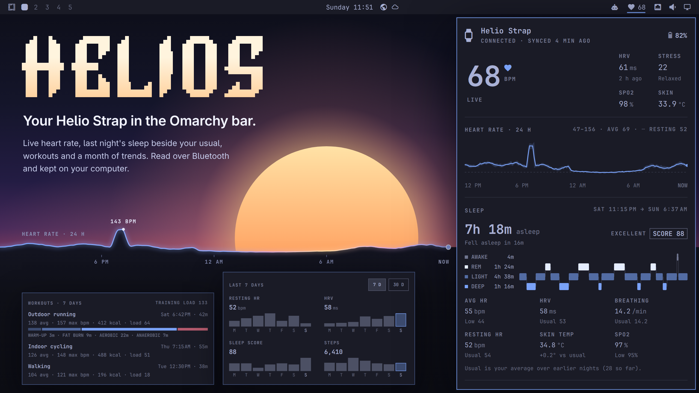

# Helios



Your Amazfit Helio Strap in the Omarchy bar. A heart and your live pulse sit in
the bar; click it for a panel with what the strap records: heart rate across
the day, the last night's sleep stages and the naps since, that night's HRV,
resting heart rate, skin temperature and breathing beside your usual, stress,
SpO2, steps, active calories, PAI, the week's workouts, a week or a month of
trends, and battery.

Everything stays on your computer. Helios talks to the strap over Bluetooth
and uses your Zepp account only once, during setup, to fetch the strap's key.

## Requirements

- Omarchy 4.5 (the version it's tested on), with Bluetooth switched on. It
  was written on 4.0.6 and uses nothing newer.
- An Amazfit Helio Strap paired with the Zepp app on your phone. Keep it paired
  there: Helios reads the strap alongside Zepp, not instead of it.
- A Zepp account that signs in with an email and password. Accounts created
  with "Sign in with Apple" or Google need a password set first.
- A network connection during setup.

Setup uses [uv](https://docs.astral.sh/uv/), which Omarchy 4.5 provides. On an
earlier Omarchy without it: `omarchy pkg add uv`.

## Install

```bash
omarchy plugin add https://github.com/atlastimed/omarchy-helios --enable
~/.config/omarchy/plugins/atlastimed.helios/setup
```

The first command adds the widget to your bar. The second sets up the service
it reads from; clicking **Set up Helios** in the widget's panel runs the same
script in a terminal. Setup shows what it will do and asks before doing it:

1. Builds a Python environment in `~/.local/share/helios/venv`. It holds two
   packages from PyPI, each checked against the hash in `uv.lock`:
   [bleak](https://github.com/hbldh/bleak) for Bluetooth and the D-Bus library
   it needs (and Python 3.13, if you don't have it). Helios itself runs from
   the plugin folder; nothing is compiled or built.
2. Fetches your strap's key from your Zepp account. You type your Zepp email
   and password into the terminal; the password is hidden and goes only to
   Zepp's servers, over connections checked against your system's
   certificates. Helios signs out again as soon as it has the key, which is
   saved to `~/.config/helios/auth.toml`, readable only by you.
3. Installs `helios.service` as a systemd user service and starts it now and
   with each graphical session.

Setup downloads nothing else and runs no other project's code. It writes
nothing inside the plugin folder, and does not need sudo.

## Use

- **Left click** the heart: open the panel. **Middle click**: sync now.
- Point at the heart rate chart for the rate at that time, at the sleep
  chart for the stage, and at a trend bar for that day's value.
- In the panel, **Enter** syncs (or runs setup when it's needed; the button it
  will press is highlighted once you use the keyboard), **S** syncs, **T**
  switches the trends between 7 and 30 days, **J**/**K** or the arrow keys
  scroll, **Esc** closes, and **Tab** moves to the next bar panel.
- Bind a key to the panel with `omarchy-shell shell toggle atlastimed.helios '{}'`.
  It opens on the monitor that has focus.

**Your usual.** Under the sleep chart, the night's HRV, resting heart rate,
skin temperature and breathing rate each sit beside "usual": the average of
up to 28 nights before that one, shown once there are seven. The night's
figures are the ones Zepp builds its Readiness from (its sleep HRV and skin
temperature are these same averages, checked night by night); the comparison
is Helios's own, not Zepp's score. Naps are the strap's own list. A very long
night can run past the 50 stages the strap keeps; the rest is drawn as a pale
band, and the stage totals still count it.

The bar shows a filled heart and your pulse while the strap streams, an
outline while it doesn't (out of range, off your wrist, or between syncs when
`live` is off), and a crossed-out heart when setup is needed.

Widget settings (Omarchy's bar settings, or the widget's entry in
`~/.config/omarchy/shell.json`):

| Setting | Default | Effect |
|---|---|---|
| `showHeartRate` | `true` | Show the number beside the heart |
| `pulse` | `false` | Beat the heart in time with your pulse (redraws the bar every beat) |
| `hideWhenAway` | `false` | Hide the widget while the strap is out of range |
| `temperatureUnit` | `auto` | `celsius`, `fahrenheit`, or `auto`: Fahrenheit only when both your locale and your timezone are American |

Service settings live in `~/.config/helios/config.toml` (optional):

```toml
live = true          # stay connected for the live pulse; false connects only to sync
sync_minutes = 10    # how often to copy new history from the strap
backfill_days = 14   # how far back the first sync reaches
keep_days = 365      # minute-by-minute history kept (0 keeps everything)
```

`live = false` spares the strap's battery and frees its connection between
syncs, at the cost of the live reading. Restart after editing:
`systemctl --user restart helios`.

For a text summary: `~/.local/share/helios/venv/bin/helios status`
(`--json` for everything).

## Update and remove

Update with `omarchy plugin update atlastimed.helios`, then run `setup` again:
it restarts the service on the new code and brings its environment in line.
The panel tells you when the widget and the service are different versions.
If the widget looks unchanged after an update, restart the shell
(`omarchy-restart-shell`): Omarchy keeps the copy of a plugin's QML it
loaded first.

To remove Helios, run setup's uninstall **before** removing the plugin, since
the script lives in the plugin folder:

```bash
~/.config/omarchy/plugins/atlastimed.helios/setup --uninstall
omarchy plugin remove atlastimed.helios
```

Your history (`~/.local/share/helios`) and key (`~/.config/helios`) are kept;
delete those folders too for a clean slate. If the plugin folder is already
gone: `systemctl --user disable --now helios`, then delete
`~/.config/systemd/user/helios.service` and the two folders.

If you pair the strap again in Zepp, its key changes: run `setup --auth`, or
click **Fetch key** in the panel. If your Zepp account has several devices
and Helios can't tell which is the strap, give its address:
`setup --auth AA:BB:CC:DD:EE:FF`.

## Privacy

- Your Zepp password is typed at a hidden prompt in a terminal and sent only
  to Zepp (`src/helios/zepp.py`), over TLS verified against your system's
  certificate store. Helios never stores or logs it, or the session it opens,
  and ends that session once it has the key. The key file is mode 600.
- Health history lives in `~/.local/share/helios/helios.db`, readable only by
  you. Nothing is uploaded anywhere.
- The service's socket (`$XDG_RUNTIME_DIR/helios/control.sock`) is mode 600.
- The service is sandboxed by systemd. Of your home folder it sees only its
  own data folder and, read-only, its code, its Python environment and the
  folder holding the strap's key; nothing else there exists for it. It has
  no network access: it reaches Bluetooth and the bar over local sockets.
- Helios acknowledges history with the strap's "keep on device" flag, so the
  Zepp app still receives everything.

## How it works

```
Helio Strap ──BLE──▶ helios.service ──Unix socket──▶ Service.qml ──▶ bar widgets
                       │
                       └─ ~/.local/share/helios/helios.db
```

`helios.service` (`src/helios/`, Python) holds the Bluetooth connection. It
authenticates with the strap's key (ECDH on NIST B-163, then AES-128, both
written out in `crypto.py` and checked against OpenSSL in the tests),
subscribes to the standard heart-rate characteristic, which the strap streams
about once a second, and every 10 minutes downloads new history, checking each
transfer's CRC. It serves the state as newline-delimited JSON: a full snapshot
when something changes, and small heart-rate events in between (only on a
change of 2 bpm or more, or every few seconds). The shell loads one client
for the plugin (`Service.qml`) and the widget on each monitor reads from it,
so nothing polls and there is one socket however many bars there are. The
service idles at well under 1% of a CPU core and about 25 MB of memory.
systemd reclaims memory from it above 96 MB and stops it at 256 MB, a limit
it has no reason to approach: no message or history transfer from the strap
is taken past a fixed size.

What the strap sends is checked before it is kept. A reading stamped more
than ten minutes ahead of this computer's clock is dropped rather than
stored, and never moves the point Helios fetches from; a number that isn't
one is dropped too. If the computer's own clock is wrong, readings wait on
the strap until it is right.

The strap's history service sometimes goes quiet on a connection that
otherwise works: fetches time out one after another, or come back "nothing
new" while the strap goes on recording. A new connection clears it, so the
service reconnects when it sees either.

When the strap leaves, Helios looks for it every 10 seconds for the first ten
minutes, then less often.

**If the connection keeps dropping.** The panel's last line shows how
strongly the computer last heard the strap, and the journal
(`journalctl --user -u helios`) records it at each connect and each drop. At
about −85 dBm and below, a turn of the wrist is enough to lose the link. A
small USB Bluetooth adapter at the back of a case is often that faint from a
metre away: a short USB extension that brings it into line of sight usually
fixes it. Other programs that scan for Bluetooth devices all the time share
the same radio and make a faint link worse.

Helios scans only while it is looking for the strap, since scanning takes
radio time from Bluetooth audio, and sets no discovery filter, because BlueZ
5.87 crashes on UUID filters (fixed upstream in `82af2beafc`).

### What the strap provides

| Reading | Source | Cadence |
|---|---|---|
| Live heart rate | GATT Heart Rate Measurement | ~1/s while connected |
| Heart rate, steps | activity history | per minute |
| Active calories | extended activity history | per minute |
| Lowest heart rate asleep | per-second heart rate history | each second, kept as minute lows and highs of 5-second medians |
| Stress | stress history | every 5 min |
| Skin temperature | temperature history | per minute |
| HRV | HRV history | per minute in measurement windows |
| SpO2 | SpO2 history (day and sleep) | every 5 min |
| Breathing rate | sleep respiratory history | per minute asleep |
| Resting heart rate | daily | once a day |
| Sleep | stages, score, totals, time to fall asleep, naps | per night, revised as it goes |
| Workouts | workout summaries: duration, heart rate, zones, calories, training effect and load | per workout |
| PAI | daily and 7-day total | daily |
| Battery | battery service | on change |

The strap also serves history types that Gadgetbridge doesn't list.
[docs/unknown-history.md](docs/unknown-history.md) records what each one
holds: per-second heart rate (`0x55`, and again as `0x57`), per-minute
active calories (`0x58`), the algorithms' diagnostic log and its index
(`0x27`, `0x4a`), the training-load state (`0x3b`), and three that are empty
or unidentified (`0x39`, `0x40`, `0x4e`). BioCharge and the Readiness score
are in none of them. Helios leaves out what it can't confirm rather than
guess what the numbers mean.

## Tested with

Omarchy 4.5.0, Quickshell 0.3.2, BlueZ 5.87, Python 3.13, a Helio Strap on
firmware 3.27.0.1 alongside the Zepp app on iOS.

## Develop

```bash
uv sync                        # Python 3.13 environment with dev tools
uv run pytest                  # protocols, parsers, store, snapshot, daemon, radio, Zepp sign-in
TZ=UTC node --test tests/model.test.mjs  # the widget's JavaScript helpers
uv run ruff check . && uv run ruff format --check .
scripts/check-plugin.sh        # Omarchy's validator and the marketplace rules
PYTHONPATH=src uv run python -m helios -v daemon  # foreground, with protocol logs (stop the service first)
```

To try a checkout as an installed plugin, commit, then
`omarchy plugin add file://$PWD` (later, `omarchy plugin update`), and restart
the shell to see widget changes.

## Licence

The service in `src/helios/` is AGPL-3.0-or-later, because it reimplements
protocol behaviour learned from Gadgetbridge. Everything else, including the
widget, is MIT. See `LICENSE` and `NOTICE.md`.

Helios is not affiliated with Amazfit or Zepp Health, and it is not a medical
device.
